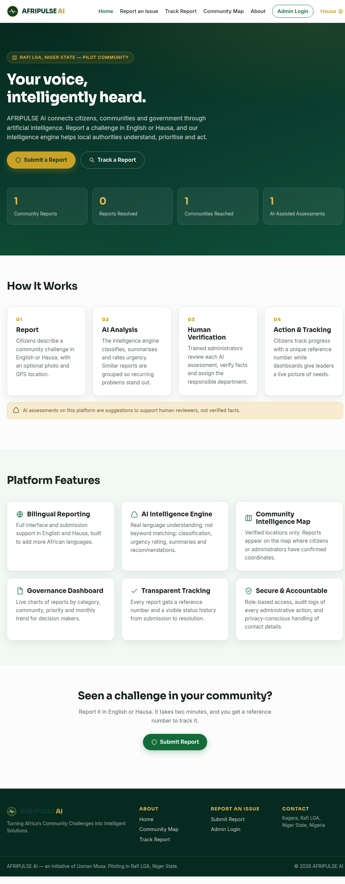
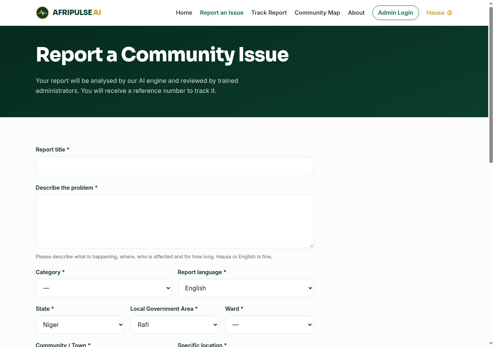
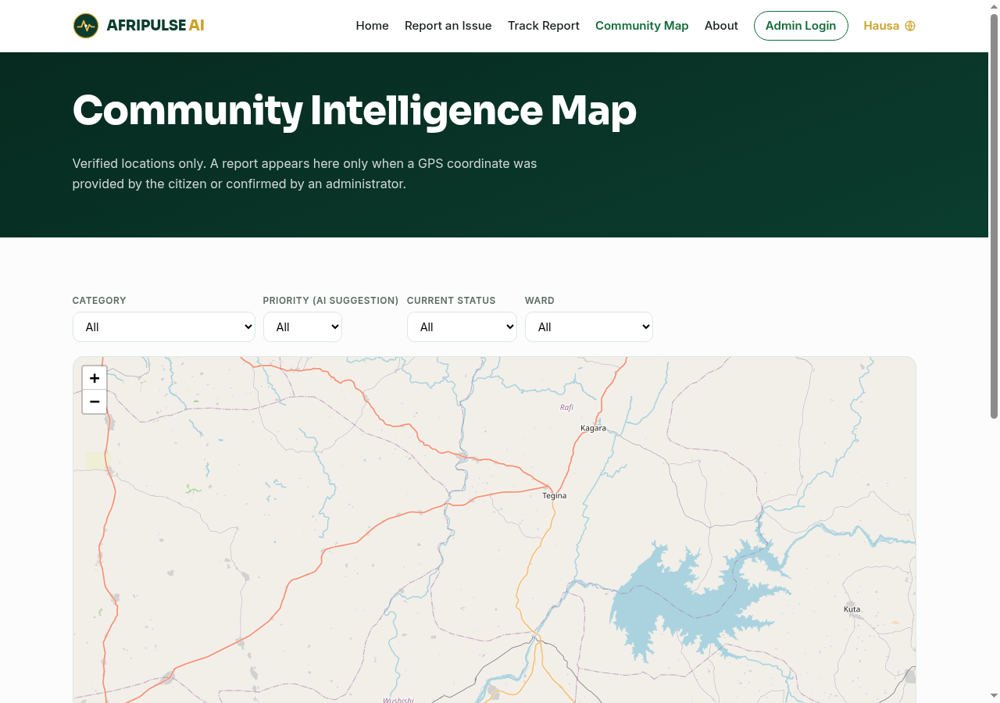
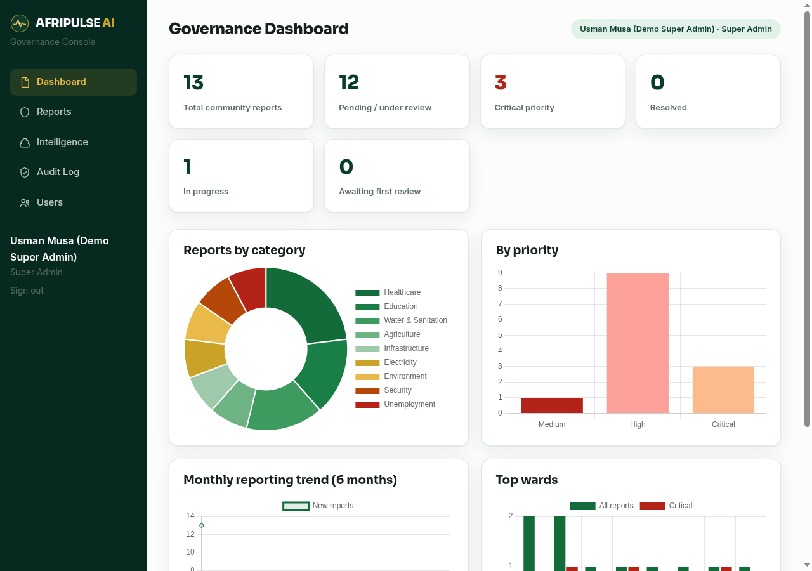
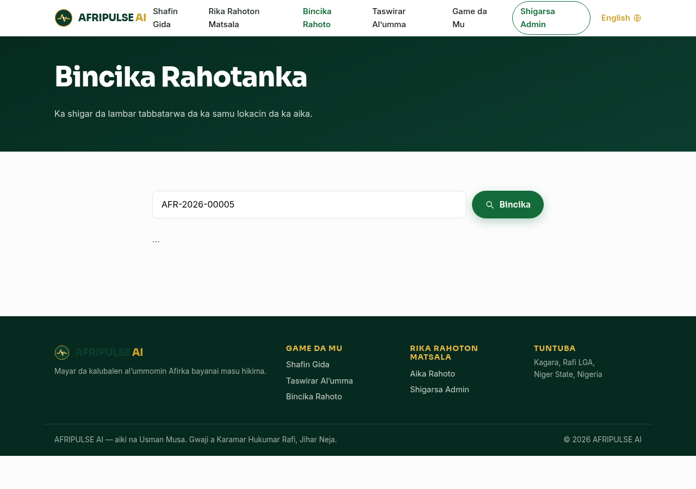
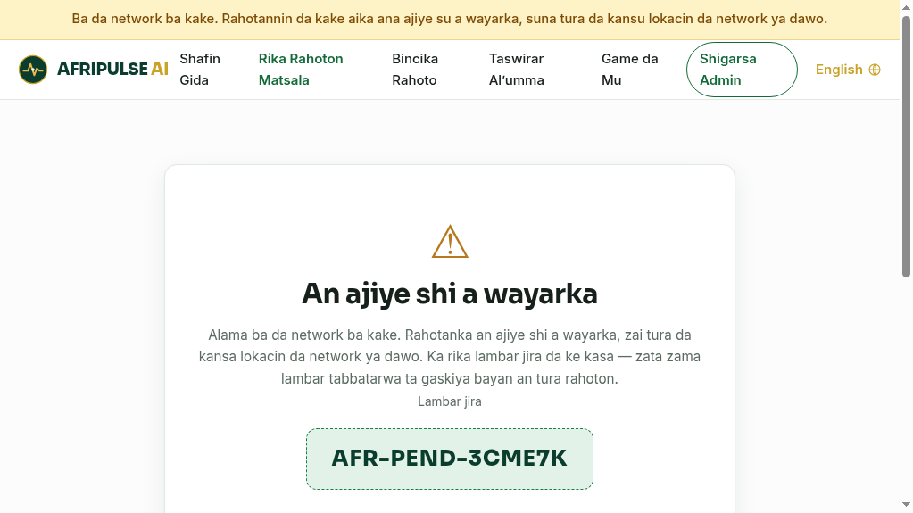

# AFRIPULSE AI 🌍

  

> **Live demo:** https://blanket-at-usman-s-works-ezen0.skydive.app/ · [Project page](https://gunnawy-gif.github.io/afripulse-ai/)

### Africa's Living Intelligence & Innovation Network

AFRIPULSE AI is an innovative project aimed at using Artificial Intelligence to identify, analyze, and help address community challenges across Africa.

## Our Mission
To transform community challenges into actionable insights and intelligent solutions.

## Planned Features
- Community Problem Reporting
- AI-Assisted Problem Analysis
- Digital Community Mapping
- Development Monitoring
- Multilingual AI Assistance

## Coverage
Geographic data covers all 36 Nigerian states plus the FCT (774 Local Government Areas, 8,700+ verified wards — sourced from Open Admin Data, CC-BY-4.0).

## Pilot Location
Rafi LGA, Niger State, Nigeria (community pilot).

## Founder
Usman Musa (Al-Gunnawy)

## Planned Technologies
- HTML
- CSS
- JavaScript
- React
- Python

## Project Status
Planning and MVP Development.

*The features listed above are planned and are not yet implemented.*

---

## Screenshots

| | |
|---|---|
|  |  |
|  |  |
|  |  |

## Technical Documentation

See [docs/TECHNICAL-DOCUMENTATION.md](docs/TECHNICAL-DOCUMENTATION.md).

## Repository Structure

- `index.ts` — webserver entry point (all routes)
- `landing.ts` — public landing pages
- `lib/` — db, auth, i18n, AI, rendering, validation helpers
- `public/` — static assets (CSS/JS)
- `schema.sql` — database schema
- `seed.ts` — demo data seeder (clearly marked demo data)

## Running

The app runs on Skydive at https://blanket-at-usman-s-works-ezen0.skydive.app/
Public pages: `/`, `/about`, `/report`, `/track`, `/map`, `/admin`, `/health`.

Environment: `DATABASE_URL` (Postgres), `WEBSERVER_PORT`.
